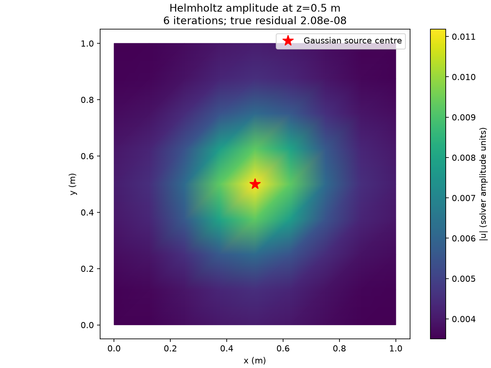

# A small Helmholtz amplitude example

This example generates its own 1 × 1 × 1 m tetrahedral box and uses the public
`HelmholtzSimulator(..., params=params).simulate()` API. It needs no city download,
server files or thesis inputs. Use the tested Helmholtz environment described in
[the installation guide](helmholtz-reproducible-install.md), with Matplotlib available.

From the repository root, with that environment active:

```bash
python demos/helmholtz_box.py --output /tmp/helmholtz-box-example
```

Choose a new output directory each time. This small example uses one MPI rank,
one worker, two structured subdomains and four coarse modes per subdomain. It
constructs 729 vertices and 3,072 tetrahedra. The solve is at 80 Hz with sound
speed 343 m/s and constant unit coefficients.

The red star marks a finite-width Gaussian source centred at (0.5, 0.5, 0.5) m,
with sigma = 0.12 m and unit source amplitude. It is not a Dirac point source.
All six exterior faces use homogeneous impedance (Robin) conditions:
`A ∂u/∂n − i k β u = 0`. There are no Dirichlet faces. No boundary labels are
needed for this all-exterior impedance case.

Open `amplitude-slice.png` in an ordinary image viewer. It shows the horizontal
cut z = 0.5 m through the source. The complex P1 field is interpolated on the
actual tetrahedron/plane intersections before taking its magnitude. Colour
shading interpolates these cut-vertex magnitudes. The colour scale uses solver
amplitude units, not calibrated pressure or sound pressure level (dB).



The shown run converged in 6 iterations with an independently evaluated algebraic
true relative residual of 2.0848 × 10⁻⁸. The script prints convergence, iterations,
residual, geometry size, source and boundary settings, and saves the same data in
`example-summary.json`. It refuses to report success if convergence fails or the
true residual exceeds 10⁻⁷. Iterations and last digits can vary with runtime;
this screenshot demonstrates the solution, not a performance benchmark or a
mesh-convergence study.

For an interactive volume view, open `field.vtu` in ParaView, select
`helmholtz_amplitude` under point data, add a **Slice** filter with normal
(0, 0, 1) and origin (0.5, 0.5, 0.5), then apply and rescale the colour range.
`helmholtz_real` and `helmholtz_imaginary` are also attached to the volume mesh.

The [small city example](../demos/helmholtz_small.py) remains available for the
external-geodata and mesh-cache workflow. The box example isolates the solver
and visualisation so it can be run without that service.
