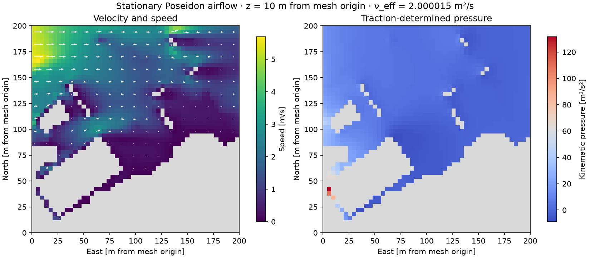

# Stationary wind verification

Measurements use DOLFINx 0.11.0, PETSc 3.25.6 with real scalars, Python 3.12,
NumPy 2.5.4 and Core 0.9.8dev on an Apple M5 Pro with 18 logical CPUs and
48 GiB memory. The timed channel runs set `OMP_NUM_THREADS`,
`OPENBLAS_NUM_THREADS` and `VECLIB_MAXIMUM_THREADS` to one.

## Accuracy and failure gates

The smooth manufactured reference has nonzero convection and an independently
specified incompressible velocity, pressure and body force. Pressure errors use
the volume-weighted zero-mean gauge.

| Cube subdivisions | Velocity L2 error | Pressure L2 error |
| --- | ---: | ---: |
| 2 | 5.04172e-2 | 1.03937e-1 |
| 4 | 1.09514e-2 | 3.16506e-2 |
| 8 | 1.05879e-3 | 7.33498e-3 |

The three-level fitted orders are 2.787 for velocity and 1.912 for pressure;
the finest-pair orders are 3.371 and 2.109. The Jacobian action differs from
centered finite differences by 5.75e-9 relative error, below the 1e-6 gate.

The planar Poiseuille reference uses `[0,2] × [0,1] × [0,1]`, `nu=0.1`,
`u=(4z(1-z),0,0)` and `p=0.8(2-x)`. It has no-slip at z=0,1, lateral slip,
and a traction outlet. Velocity and pressure L2 errors are 3.23e-11 and
1.82e-10. An analytical Navier-friction profile, explicit LU versus block
iteration, closed pressure gauges, open traction, zero forcing and two MPI
ranks are also checked.

Pressure-gauge regressions cover coordinate scales 1e-6, 1 and 1e6. Both
Jacobian actions are normalized by the pressure-coupling Frobenius norm.
Uncoupled pressure DOFs are rejected separately from the constant-pressure
gauge. Tests reject iteration limits, failed linear solves, nonfinite fields,
corrupted fields with a positive solver reason, incompatible closed inflow and
underresolved cavity flow. Failed runs preserve existing solution files.

The fixed channel acceptance limits are velocity/pressure L2 error 0.002,
dimensionless divergence 0.005 and flux imbalance 1e-4. Residual acceptance is
`max(1e-9, 1e-8 × max(initial residual,1))`. Tests use stricter analytical error
limits where the exact polynomial lies in the finite-element space.

## Channel performance

The IPCS reference source is frozen at commit `be53d0b` with the runtime guard.
Its relative-update stopping tolerance is 1e-11; all three subsolve KSPs use
rtol 1e-12 and atol 1e-14 to meet the independent stationary residual gate.
Its final independently assembled residual is 4.78e-10. The stationary residual
is 1.52e-11. Both methods reach full inlet forcing and meet every fixed gate.

| Measurement | IPCS reference | Stationary mixed |
| --- | ---: | ---: |
| Three warm runs, median solve | 71.0886 s | 0.219321 s |
| Warm solve range | 70.1808–82.0864 s | 0.215079–0.230532 s |
| Empty-JIT-cache solve | 68.3339 s | 4.67336 s |
| JIT time within cold solve | 9.51450 s | 4.43271 s |
| Cold export | 0.00322 s | 0.00394 s |
| Cold preparation + solve + export | 68.3390 s | 4.67874 s |

The warm median ratio is **324.13×** for this reference configuration. Its
convection vanishes analytically, so this ratio does not characterize
advection-dominated city flow. Cold means an empty DOLFINx JIT cache. Timings
exclude interpreter/module startup and benchmark-only error assembly. Cold and
warm samples vary with machine state and are reported separately.

## Poseidon case

The domain is 200 × 200 × 80 m, with a 12.5 m target size, 13 buildings,
`wind_speed=5`, direction 270°, log-law inlet, `nu=1.5e-5`, `nu_t=2`,
side/top slip, `grad_div_gamma=3` and `backflow_beta=2`. Cached city mesh
preparation takes 4.7908 s and reproduces the frozen mesh checksum.

The connected frozen mesh has 29,086 tetrahedra, 6,398 vertices and seven
uncoupled pressure basis functions after velocity constraints. Its composite
SHA-256 over coordinates, geometry cell map and marker values is
`361b5cc63b8a268b0c15b347f2add68297594fd8fce4e7be8dc21c8dc0b6833d`.
The stationary solver rejects this discretization by default.

Explicit local refinement of the seven cell stars yields 30,251 tetrahedra.
With explicitly selected MUMPS LU, full-convection Newton converges in five
iterations. One measured solve takes 93.99 s: setup/refinement 4.04 s, Stokes
initialization 14.82 s, nonlinear solving 74.04 s and remaining diagnostics.

| Accepted city diagnostic | Value |
| --- | ---: |
| Full inlet / convection scales | 1 / 1 |
| Independent residual / limit | 6.11e-6 / 1.14e-4 |
| RMS divergence | 0.08076 s⁻¹ |
| Dimensionless divergence | 0.001098 |
| Boundary flux imbalance | 4.73e-16 |
| Wall-normal velocity RMS | 0 m/s |
| Side/top normal velocity RMS | 5.97e-15 m/s |

Halving the Stokes initial field while restoring prescribed boundary values
changes relative sampled velocity/pressure norms by 2.31e-10 / 3.62e-10.
Refining a central region to 38,147 tetrahedra changes them by 0.588% / 0.578%
on 3,823 common fluid probes at z=10 m and z=30 m from the mesh origin. These
are sampled sensitivity checks, not a mesh-independent physical validation.



The slice has eastward mean velocity with local recirculation; grey regions
contain no fluid samples. Export checks verify field values at original native
vertices after local refinement, unchanged coordinates, native serialization,
preview calls and replacement of owned files.

The IPCS city run takes 1,405.13 s and stops at 500 steps. Its 20 s inlet ramp
reaches only 81.43% forcing at pseudo-time 16.286 s. Its full-requested-forcing
stationary residual is 3.01e4 and flux imbalance is 3.59e-4. It is nonconverged
and supplies **no valid city speed ratio**. IPCS pressure-correction outlet
constraints also differ from the mixed traction boundary, so field agreement
would not establish physical validation.

## Verification scope

The real-environment suite passes 335 tests, with six skips and three opt-in
city cases deselected. All three city cases pass when explicitly selected.
Eleven complex Helmholtz checks, four complex-runtime flow guards and the
two-rank MPI check pass. Source and wheel builds and `git diff --check` pass.

Real-environment checks cover equations, datasets, service schemas and failure
states, exports, manufactured convergence, analytical references and offline
demos. Helmholtz numerical checks run separately in the complex environment;
flow runtime rejection is checked there too. City demonstrations execute with
the frozen tagged geometry and real numerical solvers.

```bash
python -m pytest -q -m 'not expensive' \
  --ignore=tests/test_helmholtz_manufactured.py \
  --ignore=tests/test_helmholtz_numerical.py \
  --ignore=tests/test_helmholtz_source_warning.py
DTCC_WIND_CITY_MESH=/path/to/city.xdmf python -m pytest -q \
  tests/test_flow_demos.py -k city --run-expensive
```

Raw commands, frozen source, fields, mesh files, acceptance limits, version
records and timing JSON are retained in ignored `.agent/work/stationary/`.

## Limits

City meshes need boundary-corner repair before finite-element conversion, or
explicit local refinement when importing an unrepaired mesh. City examples use
the [measured iterative configuration](flow-linear-solvers.md); scalable
iterative performance on broader city geometries is not established.
General friction facets use weak normal enforcement and
can fail leakage or divergence checks. High-Reynolds-number flows can fail to
reach a stationary solution. The sensitivity probes and numerical convergence
do not validate turbulence, weather representativeness or regulatory CFD use.
